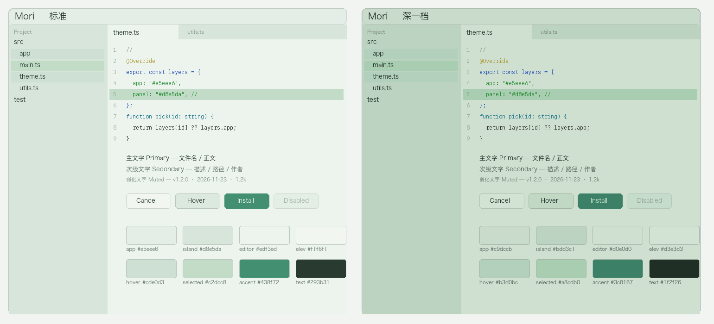

# Mori

A grey-green (mung-bean) light theme for [OpenIDEA](https://openidea.sh). Data only: no code,
no capabilities, nothing to grant.

## Why another green theme

Most "eye-friendly" themes are a green filter over the whole window: every surface, border and
selection ends up the same hue, so nothing tells you where you are. Mori keeps the mung-bean
direction but builds it as a system:

| Layer | Token | Value | Lightness |
| - | - | - | - |
| Content (editor, settings detail) | `--bg-editor` | `#edf3ed` | 94% |
| Window | `--bg-app` | `#e5eee6` | 92% |
| Secondary panels (Project, tools) | `--bg-island` | `#d8e5da` | 87% |
| Hover | `--bg-hover` | `#cde0d3` | 84% |
| Selection | `--bg-selected` | `#c2dcc8` | 81% |
| Accent | `--accent` | `#438f72` | 41% |

* **Content is brighter than the window**, panels are darker — the editor is where the eye should land.
* **Three text tiers**: `#293b31` (10.6:1), `#617469` (4.4:1), `#829389` (2.9:1).
* **Neutral borders** (`#ced8cf`, saturation ~11%) instead of green ones, so the accent stays meaningful.
* **The accent is cooler (hue 157°) than the surfaces (hue 127°)** — buttons and links don't sink into the background.
* **Semantic colours are untouched**: success, warning, danger, info, VCS, diff and the terminal ANSI palette keep the built-in values.

The whole surface sits ~12% below white in relative luminance while keeping text contrast, which is
the part that actually reduces glare — not the hue.

## Syntax

Keywords stay blue, strings stay green, annotations olive, method names teal, numbers and constants
their own colours: the theme does not repaint the code. Only the comment family moves to
`#6b7c72` (3.9:1) so it reads on a tinted background.

## Install

* From the marketplace: **Settings › Plugins › Marketplace** → Mori → Install.
* From a package: download `fgbg.mori-<version>.oiplugin` from the releases, then
  **Settings › Plugins › ⚙ › Install Plugin from Package File…**.
* Then **Settings › Appearance & Behavior › Appearance › Theme** → Mori.

## Capabilities

None. A theme plugin is data only — the manifest has no `wasm` and no `[capabilities]`, so installing
it grants no access to files, the network or processes.

## Palette provenance

The token structure follows OpenIDEA's own `src/styles/tokens.css` (Apache-2.0), which is the set of
variables a theme may override. The colour values here are their own; no third-party theme file is
included.

## License

MIT.
